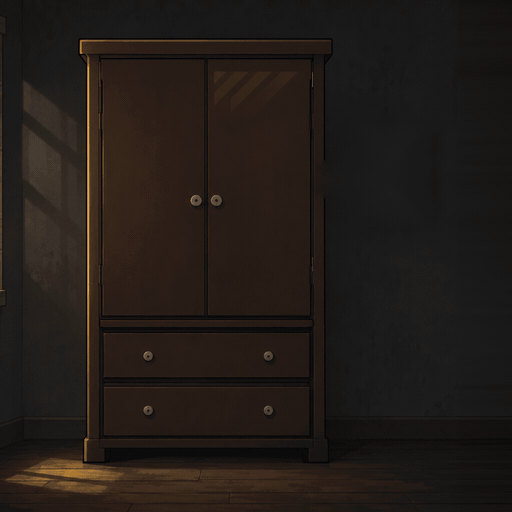

# Wardrobe Loadouts



Source repository: https://github.com/Maeiro/WardrobeLoadouts

Mod local de Project Zomboid Build 42.22.2 que salva conjuntos no próprio guarda-roupa e equipa outro conjunto usando as ações de inventário do jogo.

## O que ele faz

- Abre o gerenciador nos controles do contêiner, no clique direito e nas ações do Viewpoint ao mirar no móvel. Aceita guarda-roupas, cômodas e armários/lockers, incluindo military lockers.
- Ao guardar o equipamento atual, move as peças capturadas para dentro do guarda-roupa e registra o conjunto. Inclui roupas, bolsas habilitadas, mãos e itens acoplados a slots de cinto/coldre.
- Exibe slots fixos, inclusive vazios, sem exigir nome ou cadastro manual. **Trocar** equipa o conteúdo do slot e guarda nele o equipamento atual; **Retirar** equipa o conteúdo e libera o slot. Os itens continuam sendo as mesmas instâncias do inventário, sem cópias.
- Mantém os slots no modData do guarda-roupa. Conjuntos antigos são distribuídos automaticamente em posições estáveis; conjuntos antigos ainda vestidos podem ser guardados pelo mesmo slot.
- Usa as definições de slots carregadas pelo jogo no momento da troca, incluindo slots adicionados por mods.

## Instalação local

Para gerar o pacote, execute `tools/Build.ps1` com JDK 25 e a API 1.0 do Viewpoint. Os parâmetros `-JdkDir` e `-ViewpointApiJar` permitem informar essas instalações; o script usa as instalações locais configuradas quando omitidos. O addon é compilado com `--release 17`, sem incluir as classes da API no JAR. Extraia `dist/WardrobeLoadouts.zip` em `C:\Users\<USUARIO>\Zomboid\Workshop` ou copie a pasta `dist/WardrobeLoadouts` para lá. O resultado deve manter esta estrutura:

```text
WardrobeLoadouts/
└── Contents/
    └── mods/
        └── WardrobeLoadouts/
            ├── mod.info
            └── 42/
                ├── mod.info
                └── media/...
```

Ative **Wardrobe Loadouts** no menu Mods. Em multiplayer, instale e ative o pacote no servidor e em todos os clientes. Os dados dos conjuntos ficam no guarda-roupa do mundo, por isso continuam disponíveis depois de reiniciar.

Para liberar automaticamente o mouse nas câmeras do Viewpoint, reinicie o jogo uma vez após instalar e ative **Wardrobe Loadouts Cursor** em **Viewpoint → Advanced → Addons**, aprovando as permissões **camera** e **lua**. Esse pequeno addon Java opcional usa o `CursorClaim` da API 1.0. Enquanto a janela estiver aberta, o cursor fica livre e não gira a câmera; ao fechar, o addon libera apenas sua própria solicitação, respeitando outras janelas. Se a janela desaparecer sem fechar normalmente, a solicitação expira após dois segundos sem atualização. O gerenciador Lua funciona também sem esse addon ou sem Viewpoint. Alterações posteriores apenas na UI Lua podem usar o reload do jogo.

## Uso

1. Abra o contêiner de um guarda-roupa e selecione **Gerenciar conjuntos**, inclusive pela interação do Viewpoint.
2. Selecione um slot vazio e clique em **Guardar** para guardar fisicamente seu equipamento atual. O nome é automático.
3. Num slot ocupado, use **Trocar** para equipar suas peças e guardar o equipamento atual nesse mesmo slot.
4. Use **Retirar** para equipar o conteúdo sem guardar o equipamento anterior; as peças substituídas permanecem no inventário e o slot fica vazio.
5. Um duplo clique no slot vazio guarda seu equipamento; no ocupado, troca os conjuntos. Um clique simples seleciona sem movimentar itens.
6. Clique no slot para conferir os ícones e a ordem dos itens antes de agir. Os botões operam o slot selecionado. **Renomear**, ao lado do título, muda o nome do slot, inclusive vazio. Esse nome permanece depois de retirar as peças ou trocar de equipamento; **?** informa onde ajustar as opções ao passar o mouse.

Os nomes completos aparecem ao passar o mouse sobre os itens. Itens ausentes aparecem em vermelho e bloqueiam a troca até estarem disponíveis. A quantidade de slots segue a opção Sandbox existente, com padrão de 12. Reduzir o limite não oculta conjuntos já guardados. Em multiplayer, os slots são compartilhados e só mudam depois de o servidor conferir a transferência dos itens.

## Configuração

As opções Sandbox são compartilhadas e devem ser definidas pelo host/servidor:

- **Maximum loadouts per wardrobe**: 1–24, padrão 12.
- **Switch duration**: 0–10 segundos, padrão 0.
- **Wardrobe capacity for loadout storage**: 50–100 de capacidade, padrão 100.
- **Save and switch hand items**: inclui as duas mãos, padrão ligado.
- **Save and switch wearable bags**: inclui bolsas vestidas, padrão ligado.
- **Save and restore belt, holster, and other attached items**: salva os slots de acoplamento, padrão ligado.

Quando uma categoria é desligada, os conjuntos ignoram essa categoria e o equipamento atual fica como está. Dados salvos antes de desligá-la voltam a participar das trocas se a opção for reativada; conjuntos gravados enquanto ela estiver desligada não a capturam.

Em **Options → Mods → Wardrobe Loadouts**, ajuste o tamanho e a linguagem da interface. Há seleção automática pelo idioma do jogo e escolhas independentes para EN, ES, FR, DE, IT, PT, PT-BR, RU, CN, UA, KO, JP e TR. Os botões **- / +** ao lado de **?** ajustam a escala em passos de 5% e salvam a preferência do cliente.

**Logs de diagnóstico** fica desligado por padrão e pode ser alterado sem reiniciar. Ao ativar, registra detalhes de guardar/trocar equipamento e do cursor, além de acompanhar por 20 segundos se os itens voltam ao móvel depois de uma troca. Desligado, não executa esse acompanhamento. As mensagens de erro exibidas ao jogador continuam disponíveis.

O seletor usa nomes em inglês e códigos para permanecer legível com a fonte de qualquer idioma do jogo. As traduções da interface ficam em `42/media/lua/shared/Translate/EN/UI.json`, com chaves por idioma, lidas pelo tradutor nativo para preservar Unicode. O PZ 42.22.2 exige arquivos JSON de tradução, como `UI.json`, `IGUI.json` e `Sandbox.json`. Não coloque textos Unicode diretamente nos literais Lua: o compilador desta versão do jogo os corrompe. Depois de adicionar arquivos de tradução, reinicie o jogo para carregá-los; as escolhas de idioma seguintes atualizam a janela aberta sem reiniciar.

O botão **Ícone**, ao lado de **Renomear**, abre um catálogo pesquisável de ícones dos itens carregados, incluindo itens de mods. Também aceita o nome ou caminho de outra textura disponível no jogo. **Automático** restaura o ícone escolhido pelo conteúdo do slot. Nome e ícone persistem mesmo depois de retirar o conjunto.

As partes de um mesmo móvel compartilham loadouts, procura de itens e limite configurado de armazenamento. A ligação usa o sprite grid nativo e os contêineres internos do objeto; não agrupa armários apenas por proximidade. Os contêineres físicos e as transferências de itens continuam sendo os do jogo. Conjuntos antigos de ambas as partes são preservados, com remapeamento de IDs e slots quando necessário.

A documentação pública da API 1.0 do Viewpoint não oferece um registro específico de botões no loot panel. O acesso usa `OnFillWorldObjectContextMenu`, com o próprio móvel como alvo explícito, que o coletor de interações do Viewpoint instalado reconhece. A liberação do cursor usa o addon Java opcional descrito acima; não há dependência obrigatória de Viewpoint ou Smarter Storage.

## Compatibilidade e limites

O mod não depende de nomes específicos de slots: a restauração consulta os slots disponíveis depois de vestir as peças do conjunto. Isso permite que Alice's Weapon Sling, Vanilla Gear Expanded, Simple Flashlight on Belt e Swap It continuem usando seus próprios registros de slot. A interação real com cada combinação de mods precisa ser conferida no jogo.

O mod não duplica itens, não cria arquivos Lua de rede e não modifica os outros mods. Se uma ação for interrompida ou um slot não existir naquele conjunto, as peças ficam no inventário ou no guarda-roupa e a troca permanece marcada como não concluída. Corrija manualmente o equipamento antes de tentar a operação novamente.

## Conferência manual no jogo

Guarde dois conjuntos distintos, incluindo uma peça em cada mão e um item em coldre/cinto. Confirme que as peças aparecem dentro do guarda-roupa e que o personagem fica sem o equipamento guardado; equipe cada conjunto em sequência e confira a ordem dos itens acoplados. Reinicie o mundo e confirme que nomes e itens persistem. Em multiplayer, repita com dois personagens e confirme que o conjunto ativo de um não altera o do outro. Também confira um item de Alice's Weapon Sling, um slot de cinto do Simple Flashlight on Belt e peças do Vanilla Gear Expanded instalados.

Confira em jogo: abra o gerenciador pelo clique direito e ao mirar no Viewpoint; armazene um conjunto, escolha nome/ícone, retire-o pela outra metade do mesmo móvel e confirme a persistência. Verifique uma cômoda e um locker, os controles de escala e a seleção de idioma nas opções do cliente. A validação automatizada usa superfícies ISUI e entidades simuladas; o alinhamento final e as transferências SP/MP devem ser conferidos no jogo.

Com **Wardrobe Loadouts Cursor** ativo, abra o gerenciador em primeira pessoa e mova o mouse: o ponteiro deve navegar pela janela sem girar a câmera. Abra e feche o seletor de ícones; apenas fechar o gerenciador deve devolver o controle da câmera. Confira os botões **- / + / ? / X** em diferentes escalas e o seletor arredondado sem textos da janela principal sobrepostos.
